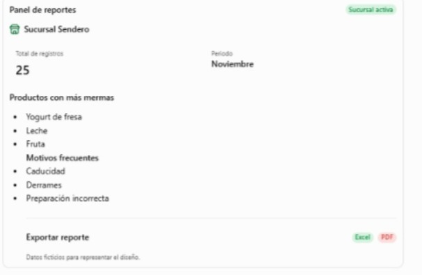

# Sistema de Registro y Control de Mermas – Yogufrut

## 1. Requerimientos funcionales

| ID | Requerimiento |
|----|---------------|
| RF01 | El sistema deberá permitir iniciar sesión mediante usuario y contraseña. |
| RF02 | El sistema deberá identificar automáticamente la sucursal a la que pertenece el usuario. |
| RF03 | El sistema deberá identificar al usuario mediante su nombre completo y puesto. |
| RF04 | El sistema deberá contemplar cuatro tipos de usuarios: empleado, encargado de turno, gerente y administrador general. |
| RF05 | El sistema deberá permitir registrar una merma indicando el producto o artículo desperdiciado. |
| RF06 | El sistema deberá permitir especificar la cantidad de producto desperdiciado y su unidad de medida. |
| RF07 | El sistema deberá permitir seleccionar el motivo de la merma, por ejemplo: caducidad, producto dañado, preparación incorrecta, sobrante o derrame. |
| RF08 | El sistema deberá permitir agregar observaciones adicionales al registro. |
| RF09 | El sistema deberá guardar automáticamente la fecha, hora, nombre del usuario y sucursal correspondiente. |
| RF10 | El sistema deberá permitir consultar el historial de mermas de cada sucursal. |
| RF11 | El sistema deberá permitir filtrar los registros por fecha, producto, motivo y usuario. |
| RF12 | El sistema deberá generar reportes individuales por sucursal. |
| RF13 | El sistema deberá permitir generar reportes por día, semana y mes. |
| RF14 | El sistema deberá permitir exportar los reportes a Excel o PDF. |
| RF15 | El administrador podrá consultar la información de todas las sucursales y seleccionar cuál desea revisar. |
| RF16 | El sistema deberá permitir identificar quién realizó cada registro. |
| RF17 | El administrador general podrá dar de alta, editar y desactivar sucursales. |
| RF18 | El administrador general podrá dar de alta gerentes y cualquier usuario; el gerente podrá dar de alta empleados y encargados de su sucursal. |
| RF19 | El administrador general o el gerente podrán restablecer la contraseña de los usuarios que administran. |
| RF20 | El producto se seleccionará de un catálogo fijo; cada producto tendrá unidad de medida y costo unitario. Solo el administrador general administra el catálogo. |
| RF21 | El sistema calculará el costo de cada merma (cantidad × costo unitario vigente al momento del registro) y mostrará totales en pesos en los reportes. |
| RF22 | Los registros no se podrán editar ni borrar. El gerente (de su sucursal) o el administrador podrán cancelar un registro indicando el motivo; la cancelación queda auditada y se excluye de los totales. |
| RF23 | Los motivos de merma serán un catálogo administrado por el administrador general. |
| RF24 | El usuario podrá adjuntar opcionalmente una foto como evidencia de la merma. |

## 2. Requerimientos no funcionales

- **Seguridad:** El acceso estará protegido mediante usuario y contraseña.
- **Usabilidad:** La plataforma deberá contar con una interfaz sencilla para facilitar el registro de mermas.
- **Disponibilidad:** El sistema deberá estar disponible para las sucursales durante sus operaciones.
- **Compatibilidad:** Deberá funcionar en navegadores como Google Chrome y Microsoft Edge.
- **Integridad:** Los registros deberán conservarse correctamente y evitar duplicidades.
- **Confidencialidad:** Cada sucursal podrá consultar únicamente su propia información, mientras que el administrador tendrá acceso general.
- **Rendimiento:** Los registros y consultas deberán realizarse de manera rápida.

## 3. Tipos de usuarios y permisos

| Usuario | Permisos |
|---------|----------|
| Empleado | Registrar mermas y consultar sus registros. |
| Encargado de turno | Registrar mermas, consultar el historial y ver el panel de reportes de su sucursal. |
| Gerente | Todo lo del encargado, más: exportar reportes (Excel/PDF), cancelar registros y gestionar empleados/encargados de su sucursal. |
| Administrador general | Consultar todas las sucursales, generar y exportar reportes, cancelar registros, gestionar sucursales, usuarios y catálogos (productos, costos, motivos). |

## 4. Información que contendrá cada registro

| Campo | Ejemplo |
|-------|---------|
| Sucursal | Sucursal Sendero |
| Nombre del usuario | Juan Pérez |
| Puesto | Encargado de turno |
| Fecha | 10/11/2026 |
| Hora | 02:30 p. m. |
| Producto | Yogurt de fresa |
| Cantidad | 3 |
| Unidad de medida | Litros (definida por el producto en el catálogo) |
| Costo | $ calculado (cantidad × costo unitario) |
| Motivo | Producto caducado |
| Observaciones | Se detectó producto vencido durante la revisión. |

## 5. Módulo de reportes

Panel de reportes que muestra exclusivamente la información de la sucursal en la que el usuario inició sesión:

- Nombre de la sucursal.
- Total de registros de mermas.
- Productos que más se desperdician.
- Principales motivos de desperdicio.
- Registros por día, semana y mes.
- Nombre de los empleados que realizaron los registros.
- Fecha y hora de cada reporte.

Mockup de referencia: 

## 6. Propuesta de funcionamiento

1. El empleado, encargado o gerente inicia sesión.
2. El sistema identifica su nombre, puesto y sucursal.
3. El usuario registra el producto que se desperdició.
4. Selecciona la cantidad y el motivo.
5. Guarda el registro.
6. La información queda almacenada y disponible para consulta.
7. El administrador puede generar reportes individuales por sucursal.

## 7. Alcance del proyecto

El sistema estará enfocado exclusivamente en el registro, seguimiento y control de mermas de las sucursales de Yogufrut. Su propósito será sustituir el registro mediante WhatsApp por una plataforma centralizada que permita identificar quién reporta, a qué sucursal pertenece, qué producto se desperdició y cuál fue el motivo.

## 8. Decisiones y supuestos (confirmados)

- **Zona horaria:** `America/Monterrey`. Formato de fecha `dd/mm/aaaa`, hora 12 h.
- **Semana:** lunes a domingo. Mes = mes calendario.
- **Productos más desperdiciados:** se ordenan por costo total ($); también se muestra número de registros.
- **Duplicidades:** el sistema advierte si el mismo usuario registra el mismo producto y cantidad en menos de 5 minutos (pide confirmación).
- **Sesión:** expira tras 8 horas o 30 minutos sin actividad. Contraseña mínima de 8 caracteres.
- **Dispositivos:** interfaz responsiva (PC, tablet y celular) en Chrome y Edge.
- **Administrador (RF15):** consulta una sucursal a la vez y además ve un resumen general con totales por sucursal.
- **Cambios de costo:** cambiar el costo en el catálogo no afecta mermas ya registradas.

### Datos iniciales

- **Sucursales:** no hay lista inicial; el administrador las da de alta desde el catálogo de sucursales (RF17). Para desarrollo se usa "Sucursal Sendero" como dato de prueba.
- **Productos:** catálogo inicial en `docs/catalogo-productos.csv` (costos estimados en MXN, ajustables por el administrador).
- **Motivos:** catálogo inicial en `docs/catalogo-motivos.csv`.
